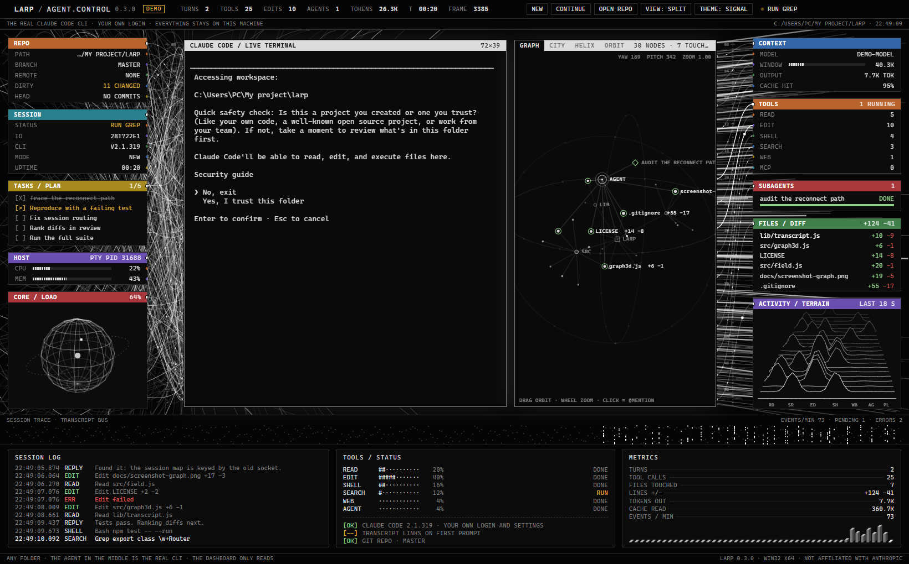
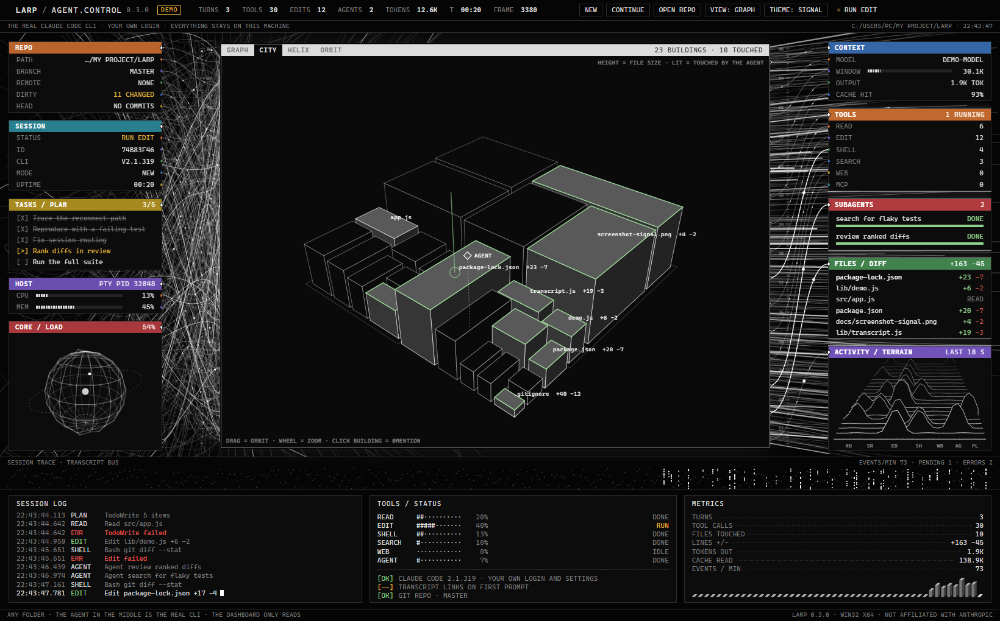
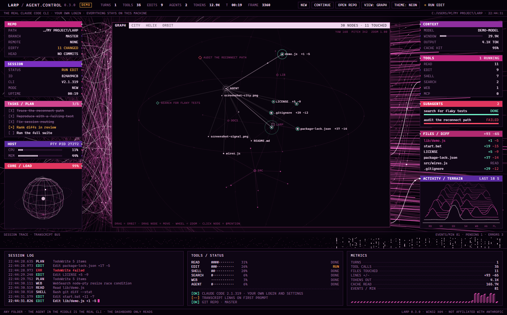
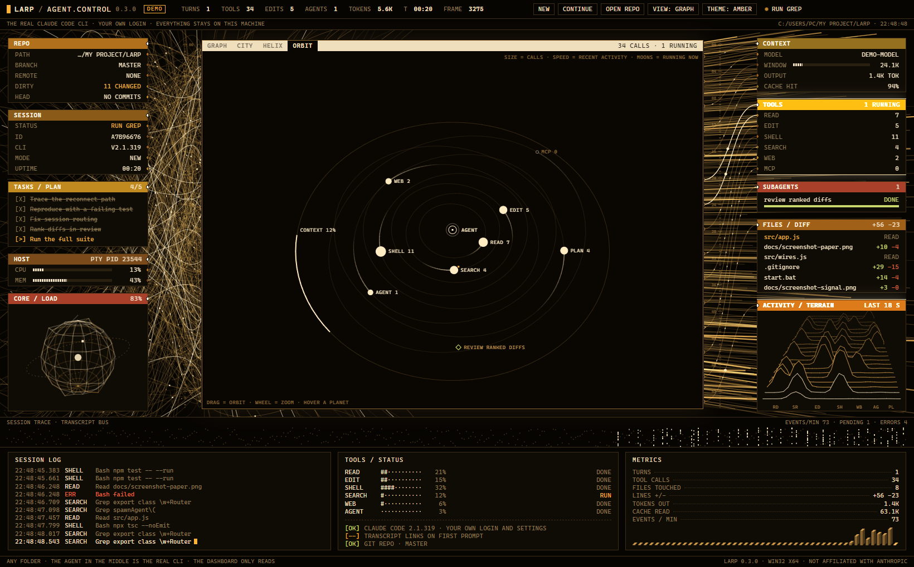
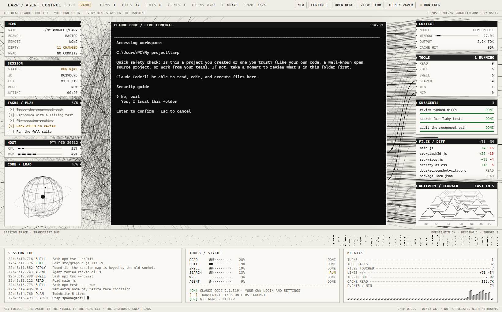

# LARP / AGENT.CONTROL

A cinematic control room wrapped around the **real Claude Code CLI**.

The terminal in the middle is not an imitation: it is the actual `claude` command running in a
pseudo-terminal, so every feature, slash command, permission prompt and keybinding works exactly as
it does in your own terminal. Everything around it is a live dashboard that reacts to what the agent
is really doing.











*(Screenshots taken in `--demo` mode, which plays a synthetic event stream. See below.)*

## What you get

- **The real CLI, untouched.** LARP spawns `claude` and gets out of the way.
- **An interactive 3D graph of your repo**, in the spirit of Obsidian's graph view: folders and
  files as nodes, with a live link from the agent to every file it really reads or edits. Drag to
  orbit, drag a node to move it, wheel to zoom, **click a node to `@mention` it in the prompt**.
- **Three more 3D scenes**, one tab each next to the graph:
  - **CITY** — the repo as a city: one building per file, height = file size, folders as districts.
    Files the agent touches light up and fire a beam, and a marker flies to the one it is working
    on. Click a building to `@mention` the file.
  - **HELIX** — the session as a spiral timeline, newest at the top: one node per prompt, reply and
    tool call, one lane per kind, a ring at each new turn.
  - **ORBIT** — tools as planets around the agent: size = calls so far, speed = recent activity,
    moons = calls running now, outer ring = how full the context window is.
- **3D instruments:** a wireframe core that spins with activity (pending tool calls orbit it), a
  receding terrain of the last seconds of activity, and an extruded activity histogram.
- **Panels fed by real data.** Tool calls, edited files with `+/−` line counts, the plan/todo list,
  subagents, token use, context size and cache hit rate are read from the session transcript Claude
  Code writes to disk. Branch, remote and dirty files come from `git`. CPU and memory from the host.
- **Patch cables and a generative field** that pulse when something actually happens: a spark runs
  down the cable of the panel concerned, and the background speeds up with activity and shifts in
  depth with the pointer. Values decode into place, counters roll, panels wipe in.
- **A request loader that takes no room.** While Claude works, the thin line under the title bar
  turns into a segmented loading bar: what it is doing, step count, elapsed time, and real progress
  when a plan exists. The taskbar icon shows it too, and flashes when the answer is ready.
- **Five themes:** `signal`, `phosphor`, `neon`, `amber`, `paper`. Cycle with the THEME button.
- **Read-only by design.** The dashboard never writes to your project or to Claude Code's files, and
  nothing leaves your machine.

## Requirements

- [Claude Code](https://claude.com/claude-code) installed and signed in. LARP uses **your own**
  login: it ships no account, no API key and no model access of its own.
- [Node.js](https://nodejs.org) 20 or newer (to run from source).

If Claude Code is not installed, LARP opens a normal shell and shows the install command.

## Run from source

```bash
git clone https://github.com/Lekiwii/larp.git
cd larp
npm install
npm start
```

On Windows you can also just double-click `start.bat`: it installs what is missing, then launches.

Open a specific folder directly:

```bash
npm start -- "C:\path\to\project"
```

## Build an installer

```bash
npm run dist
```

This produces an installer for the platform you are on in `dist/` (Windows `.exe`, macOS `.dmg`,
Linux `.AppImage`). Each platform has to be built on that platform.

## Controls

| Control       | What it does                                                       |
| ------------- | ------------------------------------------------------------------ |
| **NEW**       | Start a fresh Claude Code session in the current folder            |
| **CONTINUE**  | Resume the most recent session in the folder (`claude --continue`) |
| **OPEN REPO** | Pick another project folder                                        |
| **VIEW**      | Terminal only, terminal + 3D graph, or graph only                  |
| **THEME**     | Cycle the colour theme                                             |
| `Shift+Enter` | New line in the prompt                                             |
| `Ctrl/Cmd+C`  | Copy when text is selected, interrupt otherwise                    |

## Flags

| Flag                        | Purpose                                                              |
| --------------------------- | -------------------------------------------------------------------- |
| `--demo`                    | Play a synthetic event stream (a `DEMO` badge is shown). Costs nothing: handy for recording a clip |
| `--theme=<name>`            | Start with a given theme                                             |
| `--view=<term\|split\|graph>` | Start in a given view                                              |
| `--scene=<graph\|city\|helix\|orbit>` | Start on a given 3D scene                                  |
| `--screenshot=<file.png>`   | Capture the window after a few seconds, then quit                    |
| `--screenshot-delay=<ms>`   | How long to wait before the capture (default 7000)                   |
| `--devtools`                | Open the developer tools                                             |

```bash
npm run demo
```

## How it works

```
main.js            Electron main: spawns the CLI in a pty, polls git and host stats
lib/transcript.js  Follows ~/.claude/projects/<project>/<session>.jsonl, emits small events
lib/demo.js        Synthetic events for --demo
preload.js         The only bridge between the window and the main process
src/app.js         Terminal (xterm.js) + all panels
src/graph3d.js     The 3D force-directed repo graph (canvas, no 3D library)
src/scenes3d.js    The city, helix and orbit scenes, and their shared orbit camera
src/widgets.js     The 3D core and the activity terrain
src/field.js       The generative thread/ray field (canvas)
src/wires.js       The patch cables and their sparks (svg)
```

The graph is built from a bounded, names-only listing of the folder (at most 320 entries, 4 levels
deep, skipping `node_modules`, build output and dot-folders), so a huge repo costs the same as a
small one.

A new session is started with `claude --session-id <uuid>`, so LARP knows exactly which transcript
file belongs to it and never mixes it up with another Claude Code session open on the same folder.

## Honest limits

- The context bar assumes a 200K window (1M once usage passes 200K); the CLI's own `/context` is the
  authority.
- Line counts for edits are estimated from the tool input, not from a real diff.
- The session transcript format is internal to Claude Code and can change between versions. If a
  panel stops updating after a CLI update, the terminal itself keeps working.

## Not affiliated with Anthropic

LARP is an independent, unofficial project. "Claude" and "Claude Code" are trademarks of Anthropic.
Your use of Claude Code through LARP is governed by your own agreement with Anthropic.

## License

MIT
